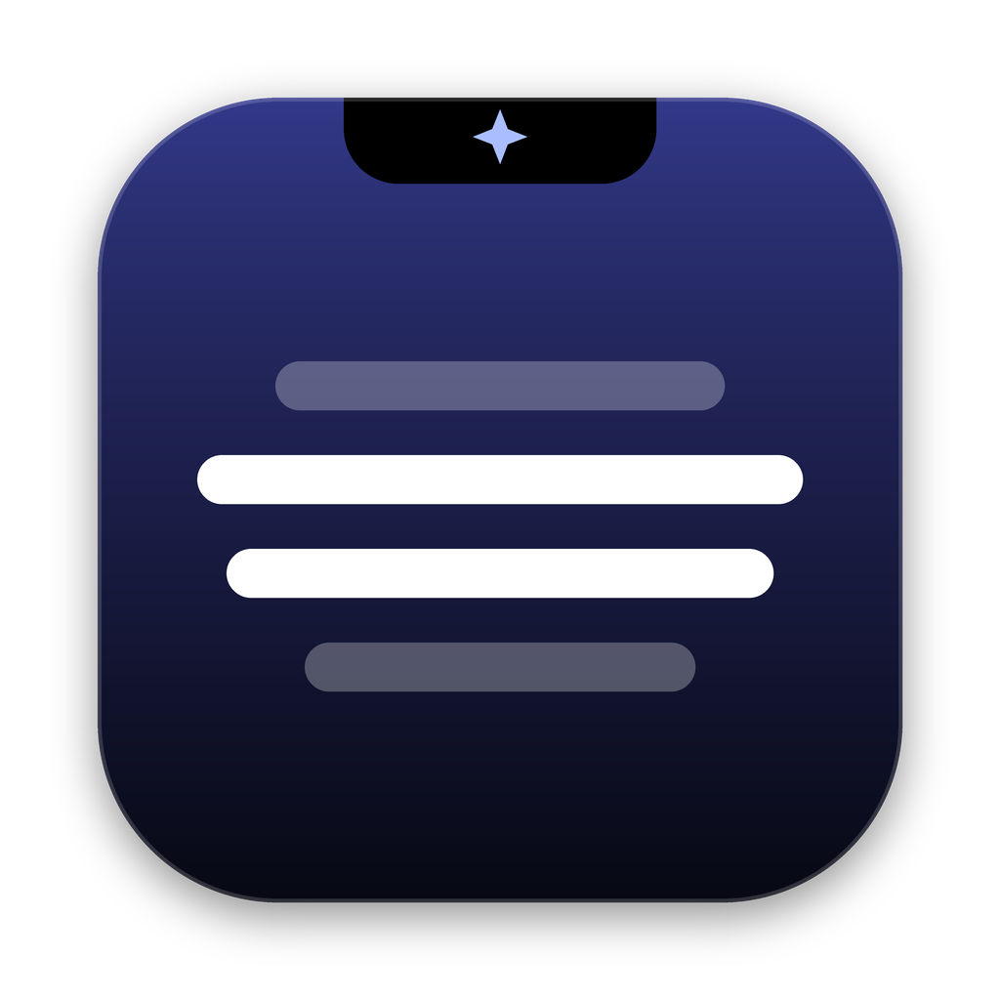

<p align="center"></p>

# NotchPilot

An AI copilot that lives in your Mac's notch. Hover the notch, tap the camera or mic, and read the answer like a teleprompter.

- **📸 Camera:** reads the question on your screen and answers it
- **🎙 Mic:** hears the question (speech-to-text runs on your Mac), then answers with your screen as context
- **Teleprompter:** answers scroll by themselves; scroll with your trackpad or use ▶︎/⏸
- **Your resume:** answers draw on your real experience, in situation → action → result form

Works with OpenAI, Anthropic, Google Gemini, any OpenAI-compatible API (Groq, OpenRouter, Ollama), or your Claude subscription through Claude Code.

## Screen sharing
NotchPilot marks its windows as private, so screen shares and recordings skip them:

- **Google Meet, Microsoft Teams, QuickTime:** nothing to set up.
- **Zoom:** open **Zoom › Settings › Share Screen › Advanced › Screen capture mode** and choose **Advanced capture with window filtering**. The "without window filtering" mode will show NotchPilot.

This is best effort, not a guarantee. On macOS 15.4 and later, Apple can let some capture tools see it anyway, so test with a practice call before a real one. And a phone camera pointed at your screen can always see it.

## Requirements
macOS 14 Sonoma or later. Best on a Mac with a notch; on other Macs it sits at the top center of the screen.

## Install

### Option A — Download the app (easiest)
1. **[Download NotchPilot.dmg](https://github.com/sideprojectmike/NotchPilot/releases/latest/download/NotchPilot.dmg)** (or pick a version on the [Releases page](https://github.com/sideprojectmike/NotchPilot/releases)).
2. Open it and drag **NotchPilot** into **Applications**.
3. Open NotchPilot. A short setup walks you through your AI key, your resume, and permissions.

If macOS says it can't verify the developer, open **System Settings › Privacy & Security**, scroll down, and click **Open Anyway** next to NotchPilot. You only need to do this once.

If it says the app "is damaged", run this once in Terminal, then open it again:
```
xattr -cr /Applications/NotchPilot.app
```

### Option B — Build it yourself
```
xcode-select --install   # once
bash build.sh
open NotchPilot.app
```
`bash release.sh` makes `dist/NotchPilot.dmg`. Pushing a tag like `v1.1` makes GitHub build and publish a release automatically (see `.github/workflows/release.yml`).

## Privacy
NotchPilot has no server and collects nothing. When you tap the camera or mic, it sends that screenshot and question straight from your Mac to the AI provider you chose, under that provider's terms. API keys are stored in your macOS Keychain. Your resume and settings stay on your Mac.

## License
MIT
